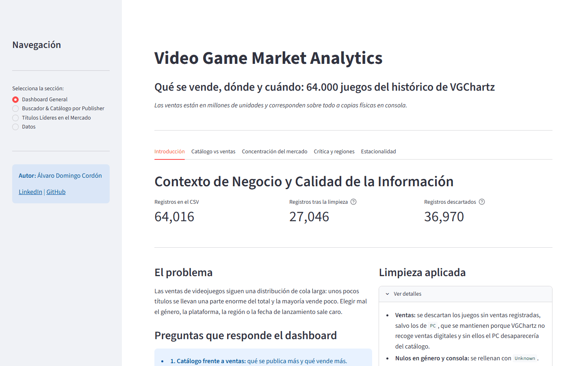
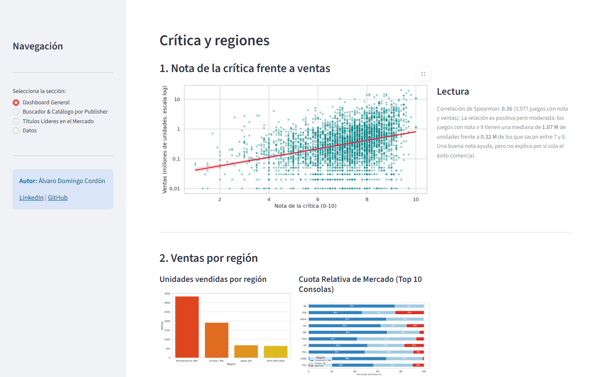

# Video Game Market Analysis

**Qué géneros, plataformas y regiones concentran las ventas de videojuegos: análisis de 64.016 juegos del histórico de VGChartz.**

[](https://video-game-market-analysis.vercel.app)    



## En resumen

- **Problema:** lanzar un juego en el género, la plataforma o la fecha equivocados sale caro, y las ventas siguen una cola larga muy desigual.
- **Datos:** VGChartz 2024: 64.016 juegos, con ventas por región para 17.570 de ellos (las ventas están en millones de unidades).
- **Resultado:** el 1 % de los juegos más vendidos acumula el 16,7 % de las unidades, el 51 % de los superventas sale en el cuarto trimestre y Japón es el mercado que más se separa del resto (lidera el rol).
- **App:** dashboard en Streamlit con buscador, catálogo por publisher y consola y ranking de superventas, ejecutado en el navegador.

## Preguntas

- ¿Qué géneros, plataformas y publishers concentran las ventas?
- ¿Cómo han evolucionado los lanzamientos y las ventas por año?
- ¿En qué se diferencian Norteamérica, Europa (PAL) y Japón?
- ¿Influye la nota de la crítica en las ventas?
- ¿En qué época del año salen los superventas?

## Datos

[VGChartz 2024](https://www.kaggle.com/datasets/asaniczka/video-game-sales-2024): 64.016 filas y 14 columnas (título, consola, género, publisher, desarrollador, nota de la crítica, ventas totales y por región, fecha de lanzamiento e imagen).

**Las ventas están en millones de unidades, no en dinero**, y corresponden sobre todo a copias físicas.

El dataset tiene muchos huecos y conviene tenerlos presentes al leer los resultados:

| Columna        | % nulos |
| -------------- | ------- |
| `critic_score` | 89,6 %  |
| `jp_sales`     | 89,5 %  |
| `na_sales`     | 80,3 %  |
| `pal_sales`    | 80,0 %  |
| `other_sales`  | 76,4 %  |
| `total_sales`  | 70,4 %  |

No he imputado ventas ni notas: con tantos nulos, rellenarlos inventaría la mayor parte de los datos. Cada análisis usa el subconjunto que tiene la información necesaria (por ejemplo, 17.570 juegos con ventas o 3.978 con nota y ventas).

## Resultados

- **Concentración:** el 1 % de los juegos más vendidos acumula el 16,7 % de las unidades, y los 10 primeros publishers el 56,7 %. La mediana de un juego es de 0,14 M de unidades.
- **Géneros:** Sports (1.188 M), Action (1.126 M) y Shooter (996 M) lideran en ventas.
- **Plataformas:** PS2 (1.028 M), Xbox 360 (860 M) y PS3 (840 M). PlayStation coloca tres consolas en el top 5.
- **Publishers:** Activision (723 M), Electronic Arts (644 M) y EA Sports (486 M).
- **Regiones:** Norteamérica suma 3.346 M de unidades, Europa 1.917 M y Japón 688 M. El género líder es Sports en Norteamérica, Action en Europa y Role-Playing en Japón. Las Xbox venden entre el 67 % y el 75 % en Norteamérica y casi nada en Japón.
- **Crítica:** la relación con las ventas es positiva pero moderada (Spearman 0,36). La mediana de ventas pasa de 0,34 M para notas de 7–8 a 1,45 M para notas de 9–10.
- **Estacionalidad:** el 51 % de los superventas (top 5 %, más de 1,44 M de unidades) sale en el cuarto trimestre.
- **Evolución:** las ventas registradas tocan techo en 2008 (538 M) y luego caen casi a cero. Esa caída es un efecto del dataset, no del mercado: VGChartz mide sobre todo ventas físicas y dejó de actualizar muchos títulos recientes justo cuando el mercado se movía a digital.

## Dashboard



La app (`App.py`) tiene cuatro secciones:

- **Dashboard general:** catálogo frente a ventas, concentración por consola, género y publisher, crítica y regiones, y estacionalidad.
- **Buscador y catálogo:** ficha de cada juego y catálogo por publisher o por consola, con filtros de año y género.
- **Títulos líderes:** ranking de los juegos más vendidos.
- **Datos:** muestra del dataset limpio.

El PC se mantiene en el catálogo aunque no tenga ventas, porque VGChartz no recoge ventas digitales. En los rankings de ventas solo cuentan los juegos con ventas registradas.

## Ejecutarlo en local

```bash
pip install -r requirements.txt
streamlit run App.py
```

El notebook está en `Notebook/Preprocesamiento.ipynb` y lee el CSV desde `../Data/`.

## Estructura

```text
├── App.py                         # Dashboard de Streamlit
├── index.html                     # Demo web (stlite)
├── Data/vgchartz-2024.csv         # Dataset
├── Notebook/Preprocesamiento.ipynb  # Limpieza y EDA
├── requirements.txt
└── LICENSE
```

## Tecnologías

Python, Pandas, NumPy, Matplotlib, Seaborn, Streamlit y Jupyter.

## Autor

Álvaro Domingo Cordón · [LinkedIn](https://www.linkedin.com/in/alvaro-domingo/) · [GitHub](https://github.com/alvarodc093-pixel)
